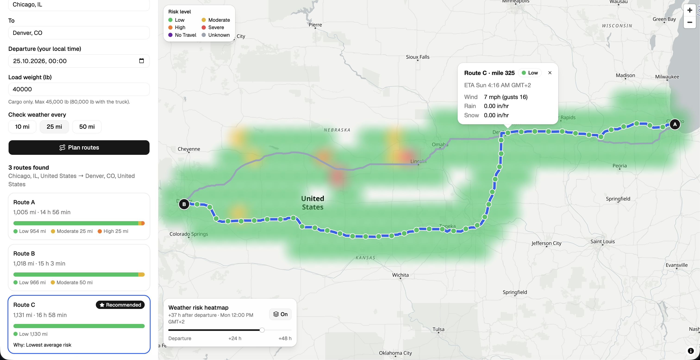

# Weather-Aware Truck Routing

A React + Django web app that helps a truck driver pick the safest route by
weather, load weight and travel time.

**Live app:** https://weather-aware-truck-routing-zeta-eight.vercel.app
· **API:** https://weather-routing-api-ck8q.onrender.com/api/health
(free hosting: the first request after idle can take up to a minute)



> Planning aid only. It does not guarantee that a route is safe or legally
> compliant.

## What it does

The driver enters origin, destination, departure time, load weight (lb) and a
checkpoint interval (10 / 25 / 50 miles). The app:

1. Gets up to 3 truck routes from HERE (truck mode, with the truck's weight).
2. Places a checkpoint every N miles and estimates the truck's arrival time
   (ETA) at each one.
3. Gets the hourly forecast for each checkpoint **at its ETA** (Open-Meteo).
4. Classifies risk per checkpoint with the thresholds and load rules below.
5. Recommends one route and says why (e.g. "Fewest Severe miles").
6. Shows routes, checkpoints (risk, ETA, weather), route summaries and a
   weather-risk heatmap along the trip corridor with a 0–48 h slider.

## How it works

```
Browser (React + MapLibre)
   │  POST /api/plan  { origin, destination, departure, load_lb, interval_mi }
   ▼
Django REST API (Render)
   ├─ HERE Geocoding ─────── "Chicago, IL" → lat/lon
   ├─ HERE Routing v8 ────── up to 3 truck routes + travel time per road stretch
   ├─ sampling ───────────── checkpoint every N miles + ETA
   ├─ Open-Meteo (via Cloudflare Worker, cached 1 h) ── hourly wind/rain/snow
   ├─ risk ───────────────── level per checkpoint (PDF thresholds + load rules)
   ├─ recommend ──────────── route summaries + ranking + reason
   └─ heatmap ────────────── grid around the routes × 49 hours of risk
   ▼
JSON → map, route cards, heatmap slider (no extra requests)
```

The risk, ranking and sampling logic are pure Python functions
(`backend/planner/risk.py`, `recommend.py`, `sampling.py`, `heatmap.py`) with
unit tests; the API clients are tested with recorded responses.

## Stack

| Part | Choice |
|---|---|
| Backend | Python 3.12, Django 5.2, Django REST Framework, gunicorn |
| Frontend | React 19, TypeScript, Vite, Tailwind CSS, shadcn/ui |
| Map | MapLibre GL JS (`react-map-gl`) + OpenFreeMap tiles |
| Routing + geocoding | HERE Routing API v8 (truck mode) + HERE Geocoding & Search |
| Weather | Open-Meteo hourly forecast, through a small Cloudflare Worker proxy (`weather-proxy/`) in production |
| Hosting | Render (backend, `render.yaml`), Vercel (frontend) |
| CI/CD | GitHub Actions; Render deploys only after CI passes |

## Risk rules

| Condition | Low | Moderate | High | Severe | No Travel |
|---|---|---|---|---|---|
| Wind (mph) | <25 | 25–34 | 35–44 | 45–54 | ≥55 |
| Rain (in/hr) | <0.10 | 0.10–0.25 | 0.25–0.50 | 0.50–1.00 | >1.00 |
| Snow (in/hr) | <0.5 | 0.5–1.0 | 1.0–2.0 | 2.0–3.0 | >3.0 |

Load rules: ≥55 mph → No Travel for any load · 45–54 mph and load >30,000 lb →
No Travel · 35–44 mph and load >40,000 lb → Severe.

Recommendation order: avoid No Travel miles (if another route has none) →
fewest Severe miles → fewest High miles → lowest average risk → shortest
travel time.

## Key decisions

- **Wind:** sustained wind; gusts are shown as info only.
- **Edges:** lower bound inclusive (rain 0.25 → High); rain 1.00 and snow 3.0
  are Severe (No Travel is strictly `>`).
- **Checkpoint risk:** the worst of wind / rain / snow, after load rules.
- **Miles at a level:** each checkpoint covers the miles since the previous
  one; average risk = Low 0 … No Travel 4, weighted by miles.
- **Missing weather:** shown as Unknown (grey), never as Low.
- **ETA:** HERE travel time per road stretch, so slow city and fast highway
  parts are timed correctly; the forecast hour nearest the ETA is used.
- **Rain:** Open-Meteo `rain` + `showers`; hourly amount = in/hr rate.
- **Weight:** risk rules use the cargo load; HERE gets gross weight
  (load + 35,000 lb empty truck). Max load 45,000 lb → ≤ 80,000 lb gross.
- **Heatmap:** the same risk levels on a grid around the routes, per forecast
  hour (hour 0 = departure). Drawn as blurred circles in the level colors, so
  nearby points never add up to a higher level than the data says.
- **Scope:** USA only; departure up to 7 days ahead (forecast range).

## Performance

- Weather points are rounded to a 0.1° grid, de-duplicated, fetched in
  batches of 100 and cached for 1 hour per grid cell.
- One `/api/plan` request returns everything; the heatmap holds all 49 hours,
  so the slider only changes a map paint expression (no requests, no data
  rebuild).
- Routes, checkpoints and the heatmap are GPU layers (no DOM markers); route
  lines are thinned to one point per 0.5 mile.

## Project structure

```
backend/                 Django API
  planner/risk.py        risk levels + load rules
  planner/recommend.py   route summary + ranking + reason
  planner/sampling.py    checkpoints every N miles + ETA
  planner/heatmap.py     corridor grid + hourly risk
  planner/plan.py        /api/plan flow
  planner/clients/       HERE + Open-Meteo clients
  planner/tests/         unit tests + recorded API responses
frontend/src/            React app
  api.ts, types.ts       API client + response types
  risk.ts, format.ts     colors, labels, formatting
  map-data.ts            GeoJSON + map expressions
  components/            form, map, route cards, heatmap control, legend
weather-proxy/           Cloudflare Worker that forwards Open-Meteo requests
render.yaml              Render deployment
```

## Run locally

Backend (needs Python 3.10+, developed on 3.12):

```bash
cd backend
python3 -m venv .venv
source .venv/bin/activate
pip install -r requirements.txt
cp .env.example .env   # add your HERE_API_KEY
python manage.py runserver
```

Check: `curl localhost:8000/api/health` → `{"status": "ok"}`

Frontend (needs Node 20+):

```bash
cd frontend
npm install
cp .env.example .env   # VITE_API_URL=http://localhost:8000
npm run dev            # http://localhost:5173
```

## Tests and CI

- Backend: `python manage.py test` (109 tests: risk edges, load rules,
  ranking, sampling/ETA, heatmap, validation, API clients, endpoint).
- Frontend: `npm test` (36 tests), `npm run lint`, `npm run build`.
- GitHub Actions runs both on every push, plus a type check (basedpyright)
  and a format check; Render deploys the backend only when CI is green.

## API

`GET /api/health` — server check.

`POST /api/plan` — plans a trip.

```json
{ "origin": "Chicago, IL", "destination": "Denver, CO",
  "departure": "2026-10-24T13:00:00Z", "load_lb": 42000, "interval_mi": 25 }
```

Returns the geocoded places, up to 3 routes (line, distance, time,
checkpoints with ETA, weather and risk, risk summary), the recommended route
with the reason, and the heatmap (grid points × 49 hourly risk values).

Errors: `{"error": "<code>", "message": "..."}` — `invalid_input` (400, plus
`fields`), `place_not_found` / `no_route` (404), `routing_unavailable` /
`weather_unavailable` / `weather_rate_limited` (502).

## Limitations

- HERE returns fewer than 3 routes when there is no reasonable alternative
  (common on short trips).
- Load weight changes the route only where roads have weight limits; on
  interstates it mainly affects the risk rules (strong wind).
- Forecasts get less accurate further ahead; free hosting sleeps when idle.
